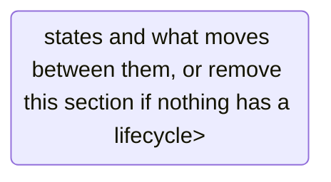

# App Flow: <fill: application name>

> How people move through the application, including when things go wrong.
> For an application with no screens, describe the calls or commands instead.

## Entry points
<fill: how each kind of user arrives, and what they can reach before signing in>

## Screen or endpoint map
```mermaid
flowchart TD
  <fill: every screen or endpoint group, and how they connect>
```

## Journeys
One per main task. Name the feature each one serves.

### <fill: journey name> (<fill: F-n>)
```mermaid
flowchart TD
  <fill: steps, decisions and outcomes>
```

## State changes
For anything with a lifecycle, such as an order or an invitation.



## Error paths
| What goes wrong | What the user sees | How they recover |
|---|---|---|
| <fill: failure> | <fill: message or screen> | <fill: next step> |

## Open questions
- <fill: what is still undecided, or "None">
